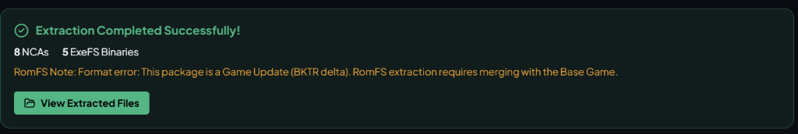

# Switch Extractor

<p align="center">
  
</p>

<p align="center">
  <strong>A high-performance native desktop tool for inspecting, browsing, verifying, and extracting Nintendo Switch 1 container archives (<code>.nsp</code>, <code>.nsz</code>, <code>.xci</code>, <code>.xcz</code>, <code>.nca</code>) with BKTR delta merging and structured DLC unpacking.</strong>
</p>

<p align="center">
  🌐 <strong>Official Showcase &amp; Live Web Page:</strong> <a href="https://spin0zai.github.io/Switch-1-extractor/"><strong>spin0zai.github.io/Switch-1-extractor</strong></a>
</p>

<p align="center">
  <a href="https://spin0zai.github.io/Switch-1-extractor/"></a>
</p>

<p align="center">
  <a href="https://github.com/SPIN0ZAi/Switch-1-extractor/releases/latest"></a>
  <a href="LICENSE"></a>
  <a href="https://www.rust-lang.org"></a>
  <a href="#"></a>
  <a href="#"></a>
</p>

---

## 📸 Screenshots

<p align="center">
  
  <br>
  <em>Extraction Workspace — Dedicated Base Game, Game Update (BKTR Delta), and Multi-DLC slots with auto-matching, live decryption progress, and hardware stats.</em>
</p>

---

## ⚡ Overview

**Switch Extractor** is a standalone 64-bit Windows GUI utility built to decrypt, inspect, and unpack Nintendo Switch 1 container archives without requiring Python, command prompts, or heavy external runtimes.

Rather than relying on terminal scripts or slow file-by-file Python loops, Switch Extractor is engineered as a **pure native Windows application (`WinExe`)** featuring:
- **Zero Command Prompt Window**: Launches instantly into a sleek, hardware-accelerated desktop window.
- **Zero UI Freezing ("Not Responding")**: Powered by a multi-threaded Tokio Rust backend where all cryptographic operations, BKTR relocation tree decryption, and I/O run asynchronously. The UI remains completely fluid at 60+ FPS.
- **Hardware AES Acceleration**: Utilizes hardware AES-NI instructions for AES-128-XTS header decryption and high-throughput AES-128-CTR sector streaming.
- **BKTR Delta RomFS Relocation**: Dynamically relocates and layers Game Update patches on top of the Base Game's RomFS tree on-the-fly, producing 100% complete merged filesystems without intermediate copies.
- **In-Memory Zero-Copy Repacking**: Streamed XCI ➔ NSP conversion with zero temporary disk usage.

---

## ✨ Features

- **🎨 Nintendo Switch OLED Precision UI**: Obsidian high-contrast theme with Joy-Con Neon Coral (`#FF3B53`) and Cyan (`#00E5FF`) accents, live activity logs, and responsive layout.
- **🧩 Multi-Slot Extraction (Base + Update + DLCs)**:
  - **Base Game Slot**: Select or drag-and-drop `.nsp`, `.nsz`, `.xci`, or `.xcz`.
  - **Game Update Slot**: Pairs Game Updates with Base Games for on-the-fly BKTR delta merging.
  - **DLC Content Packages**: Multi-select DLC archives unpacked into structured directories (`dlc/DLC_XX_<id>/romfs/`).
  - **Smart Title ID Auto-Detection**: Automatically detects matching update (`...800`) and DLC (`...001`, `...002`, `[DLC]`) files in the source directory.
- **🖼️ Rich Embedded Metadata & Cover Artwork**:
  - Reads localized NACP titles across 16 languages, version strings, publishers, and Title IDs.
  - Displays high-resolution embedded JPEG/PNG cover artwork.
- **⚡ Comprehensive Format Support**:
  - **`.NSP` / `.PFS0`**: Standard Nintendo Submission Packages.
  - **`.XCI` / `.HFS0`**: GameCard dumps with root, update, and secure partition trees.
  - **`.NSZ` / `.XCZ`**: Compressed packages with solid Zstandard decompression.
  - **`.NCA`**: NCA3, NCA2, and NCA0 content archives.
  - **RomFS & ExeFS**: Hierarchical folder extraction and executable decryption (`main`, `main.npdm`, `rtld`, `subsdk*`).
- **🔑 Automated Keys Discovery**:
  - Automatically locates and parses `prod.keys` and `title.keys` from Yuzu (`%APPDATA%/yuzu/keys`), Ryujinx (`%APPDATA%/Ryujinx/system`), and local directories.
- **🔄 In-Place Auto-Updater**:
  - Background update check via GitHub Releases API or on-demand via Settings.
  - Streaming download telemetry with live MB/s transfer speed.
  - Atomic Windows self-replacement: renames executing binary to `.old`, writes the new executable, and relaunches without file lock conflicts.

---

## 🚀 Download & Installation

### Option 1: Direct Standalone Executable (Recommended)
Download the latest pre-compiled standalone executable from the [Releases](https://github.com/SPIN0ZAi/Switch-1-extractor/releases/latest) page:

1. Download **`Switch_Extractor.exe`** (or **`Switch_Extractor-windows-x64.zip`**).
2. Double-click **`Switch_Extractor.exe`** to launch!

*(No installer, Python installation, or Visual C++ redistributables required—everything is statically linked!)*

> **Note**: Switch Extractor uses the Microsoft Edge WebView2 runtime, which is pre-installed on all Windows 10 (version 1803+) and Windows 11 machines.

---

## 🛠️ Building from Source

### Prerequisites
- Windows 10 / 11 (64-bit)
- [Rust](https://rustup.rs/) with MSVC toolchain (`stable-x86_64-pc-windows-msvc`)
- Visual Studio Build Tools (C++ Build Tools component)
- [Node.js](https://nodejs.org/) (v18+)

### 1. Clone the Repository
```powershell
git clone https://github.com/SPIN0ZAi/Switch-1-extractor.git
cd Switch-1-extractor
```

### 2. Run Automated Test Suite
```powershell
cargo test --manifest-path crates/switch-extractor-core/Cargo.toml
```

### 3. Build Standalone Executable
You can use the 1-click batch script:
```powershell
.\build_native.bat
```
Or build manually via npm and Tauri:
```powershell
npm install
npm run tauri build -- --no-bundle
```
The compiled, standalone executable is generated at:
`src-tauri/target/release/switch-extractor-desktop.exe` (and copied to `dist/SwitchExtractor.exe`).

---

## 📁 Repository Structure

```text
switch-extractor/
├── .github/
│   ├── ISSUE_TEMPLATE/       # Bug report, feature request, task templates
│   ├── workflows/            # GitHub Actions (Build & Release, CI, Pages)
│   └── PULL_REQUEST_TEMPLATE.md
├── crates/
│   └── switch-extractor-core/# Pure Rust cryptographic and extraction engine
├── src-tauri/                # Tauri v2 desktop host & native Windows commands
├── src/                      # React, TypeScript, Tailwind CSS v4, Zustand UI
├── docs/                     # Technical specifications & Git Flow workflow
├── website/                  # Showcase landing page (GitHub Pages)
├── legacy_python/            # Original Python implementation (preserved)
├── dist/                     # Compiled standalone executable
├── build_native.bat          # 1-Click test & release build script
├── README.md                 # Project documentation
└── LICENSE                   # MIT License
```

---

## 📄 License & Legal Disclaimer

- **License**: Released under the [MIT License](LICENSE).
- **Clean-Room & Legal Notice**: **Switch Extractor** is an independent archive extraction and interoperability utility. It contains no proprietary Nintendo code, copyrighted game assets, or pre-packaged encryption keys (`prod.keys`). Users must provide their own legally dumped keys from their personal console for backup verification.
